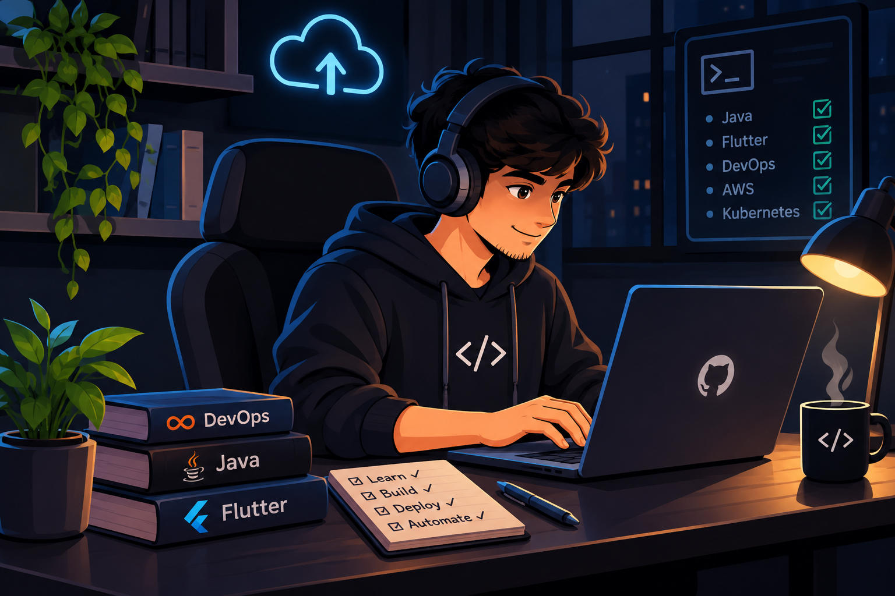

 

---

# 👨‍💻 ABOUT ME

### Hey there! I'm Anurag Chavan 👋

I'm a passionate **DevOps Engineer and Software Developer** interested in building scalable applications, automating infrastructure, and exploring modern technologies.

I have good hands-on experience with **Java Programming**, along with an interest in application development using **Flutter**. I also enjoy working with DevOps tools and cloud technologies to understand how applications are developed, deployed, and managed.

- 🚀 Exploring DevOps practices and CI/CD pipelines.
- ☁️ Learning cloud infrastructure with AWS.
- 💻 Good hands-on programming with Java.
- 📱 Flutter developer interested in cross-platform applications.
- 🐳 Working with Docker and Kubernetes.
- 🏗️ Exploring Infrastructure as Code using Terraform.
- 🐧 Learning Linux, scripting and system administration.
- 🎯 Always curious to learn, build and automate.

> "Code. Build. Deploy. Automate. Repeat."

---

# 🛠️ TECH STACK

### 💻 Programming Languages

### ☁️ Cloud & DevOps

### 🧠 Concepts & Core Knowledge

### 🗄️ Databases

### 🔧 Tools & Platforms

### 📱 Development

---

# 🚀 FEATURED PROJECT

### 📚 DevOps Learning Repository

A practical collection of my DevOps learning notes, commands and hands-on implementations.

**Topics covered:**

🐧 Linux | ☁️ AWS | 🐳 Docker | ☸️ Kubernetes | 🏗️ Terraform

---

# 📊 GITHUB STATISTICS

  

---

# 🤝 CONNECT WITH ME

Let's connect, collaborate and build something amazing!

 

  

### ⭐ Thanks for visiting my profile!

### Keep Learning. Keep Building. Keep Growing. 🚀

